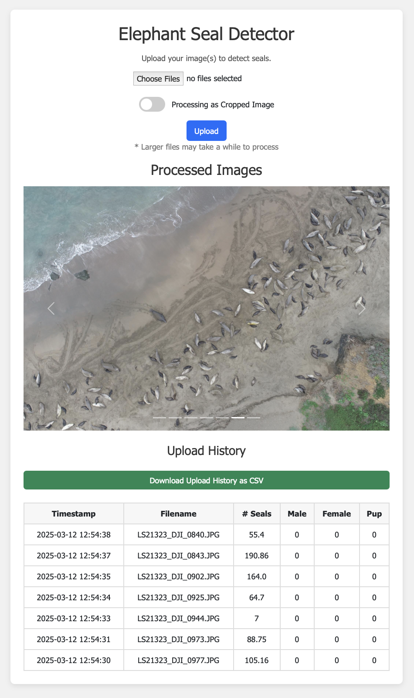

# Elephant Seals Detection Web App

<p align="center">
  
</p>

---

## 🚀 Overview

This web app automatically detects and counts central coast elephant seals in aerial images.

- Multi-image upload (JPEG and PNG)  
- Real-time detection via Roboflow + custom “de-clumpifier”  
- Interactive carousel, zoom, and pan UI  
- Downloadable CSV of results  

---

## 🛠 Prerequisites

Before you begin, ensure your system has:

- **Python 3.8 – 3.12**  
- **pip** package manager  
- A **Roboflow API Key** (free at https://roboflow.com)

---

## 🐍 Installing Python

If you don't already have Python:

1. Visit the official download page: https://www.python.org/downloads/  
2. Choose a version between 3.8 and 3.12 for your operating system.  
3. Download and run the installer.  
   - **Windows users:** check “Add Python to PATH” before installing.  
4. Verify in a terminal:
   ```bash
   python --version
   # Expected output: Python 3.x.x
   ```

---

## 📥 Cloning & Installing Dependencies

Open a terminal and run these copy‑and‑paste commands:

```bash
# 1) Clone the repo to your local machine
git clone https://github.com/yourusername/elephant-seals-detection.git

# 2) Change into the project directory
cd elephant-seals-detection

# 3) Create a Python virtual environment (isolated workspace)
python -m venv .venv

# 4) Activate the virtual environment:
# macOS/Linux:
source .venv/bin/activate
# Windows (PowerShell):
.venv\Scripts\Activate.ps1

# 5) Upgrade pip and install requirements
pip install --upgrade pip
pip install -r requirements.txt
```

---

## 🔧 Configuration

Create a `.env` file in the project root to supply your Roboflow key:

```bash
# while in the repository root:
echo "ROBOFLOW_API_KEY=YOUR_API_KEY_HERE" > .env
```

---

## ▶️ Running the Web App

```bash
# 1) Enter the source directory
cd src

# 2) Launch the Flask server
python app.py
```

Open your browser to **http://localhost:5000** to access the app.

---

## 🖥️ Using the CLI Tool


Check out our CLI tool for model building and evaluation: [Elephant Seals CLI Tool](https://github.com/brandonhjkim/elephant-seals-CLI)

---

## 🤝 Contributing

Contributions are welcome, however this project is currently not accepting pull requests. If you have suggestions or improvements, please open an issue.
